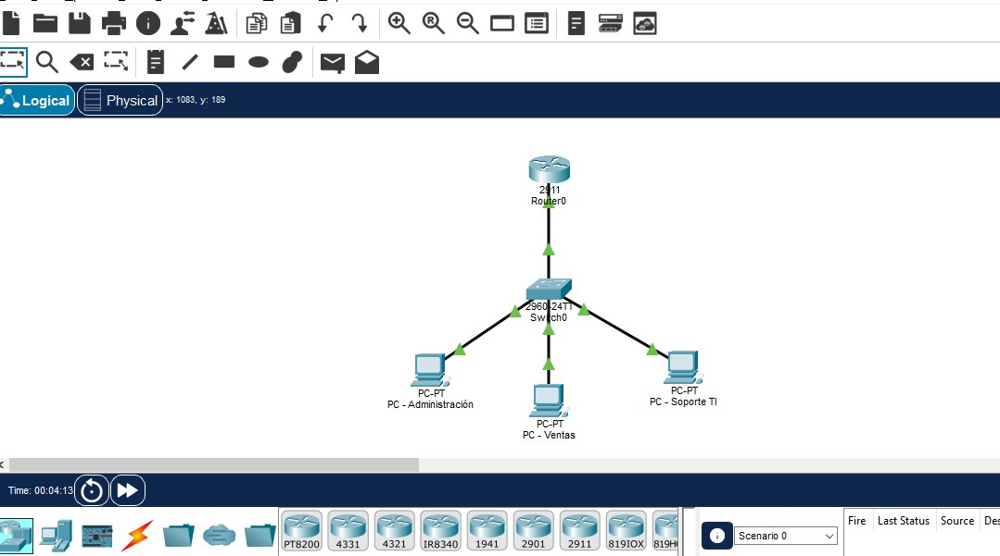

# Proyecto 01: Segmentación de red empresarial con VLANs

## 1. Descripción

Laboratorio de redes empresariales desarrollado en Cisco Packet Tracer para practicar la segmentación de una red mediante VLANs, la configuración de enlaces troncales 802.1Q, el enrutamiento entre VLANs y la asignación automática de direcciones IP mediante DHCP.

## 2. Objetivos

- Crear y configurar VLANs para separar departamentos.
- Configurar puertos de acceso y un enlace trunk.
- Implementar router-on-a-stick para permitir la comunicación entre VLANs.
- Configurar DHCP para asignar direcciones IP automáticamente.
- Verificar conectividad y diagnosticar problemas básicos de red.

## 3. Topología

La red está compuesta por:

- 1 router Cisco 2911.
- 1 switch Cisco 2960.
- 3 computadoras, una por departamento.

## 4. Plan de direccionamiento

| VLAN | Departamento | Red | Gateway |
------------------------------------------
| 10 | Administración | 192.168.10.0/24 | 192.168.10.1 

| 20 | Ventas | 192.168.20.0/24 | 192.168.20.1 |

| 30 | Soporte TI | 192.168.30.0/24 | 192.168.30.1 |

## 5. Tecnologías y conceptos

- VLANs
- IEEE 802.1Q
- Trunking
- Router-on-a-stick
- Inter-VLAN routing
- DHCP
- IPv4
- Cisco IOS CLI
- Troubleshooting

## 6. Validaciones realizadas

- Configuración de las VLANs y puertos de acceso.
- Configuración del enlace trunk entre el switch y el router.
- Configuración de subinterfaces para el enrutamiento entre VLANs.
- Asignación automática de direcciones IP mediante DHCP.
- Revisión de los pools y las concesiones DHCP.
- Pruebas de conectividad entre equipos.

## 7. Comandos de verificación

```text
show vlan brief
show interfaces trunk
show interfaces gi0/1 switchport
show ip interface brief
show ip route
show ip dhcp pool
show ip dhcp binding
```

## 8. Aprendizaje y troubleshooting

Durante la práctica se identificó que el enlace trunk no aparecía en `show interfaces trunk` porque la interfaz física del router estaba apagada administrativamente. Después de habilitarla, se pudo verificar el enlace y las VLANs permitidas.

## 9. Herramientas

- Cisco Packet Tracer
- GitHub para documentar y versionar el proyecto

## 10. Mejoras futuras

- Aplicar restricciones de comunicación entre VLANs mediante ACLs.
- Incorporar una VLAN de gestión.
- Añadir un servidor y servicios de red.
- Practicar fallos intencionales y documentar su diagnóstico.

**Estado:** laboratorio básico configurado. Las pruebas de fallos intencionales quedan pendientes.

## 11. Evidencias del laboratorio

 Topología de red
 


 VLANs configuradas
 


 Enlace trunk
 


 DHCP funcionando
 


 Prueba de conectividad
 

